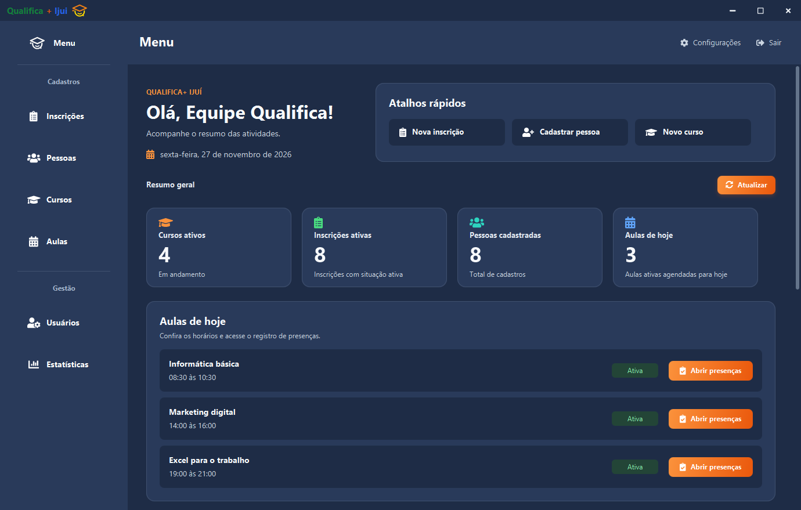
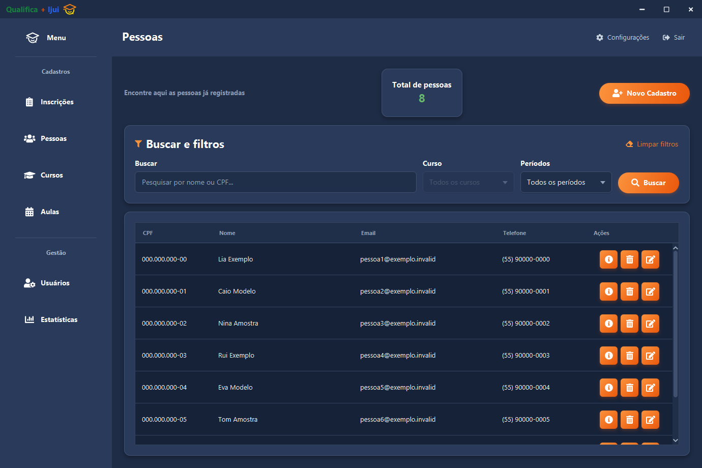
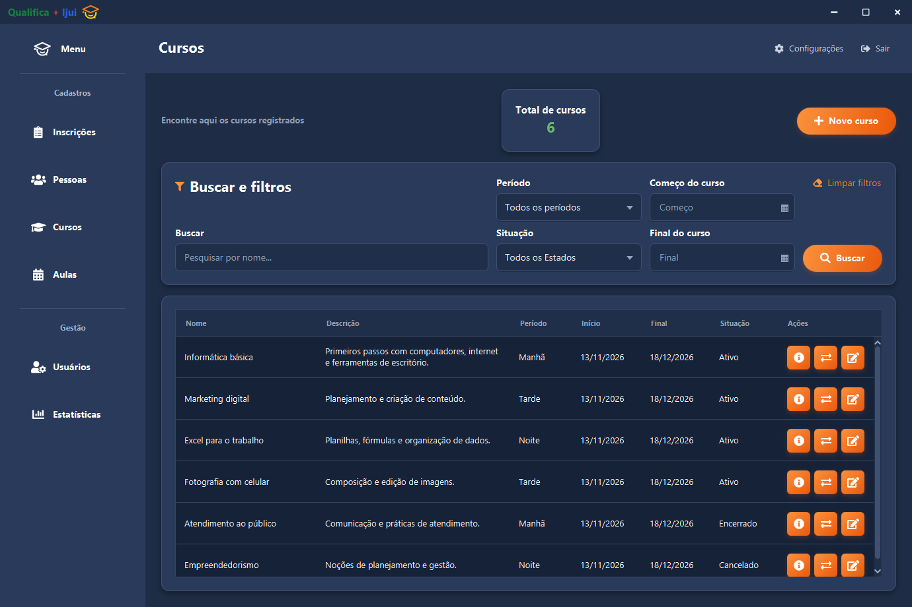
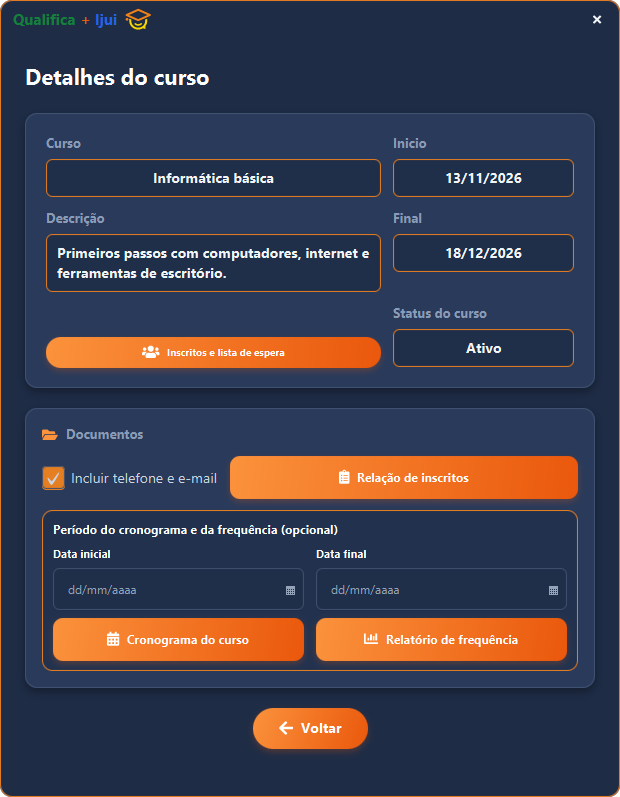
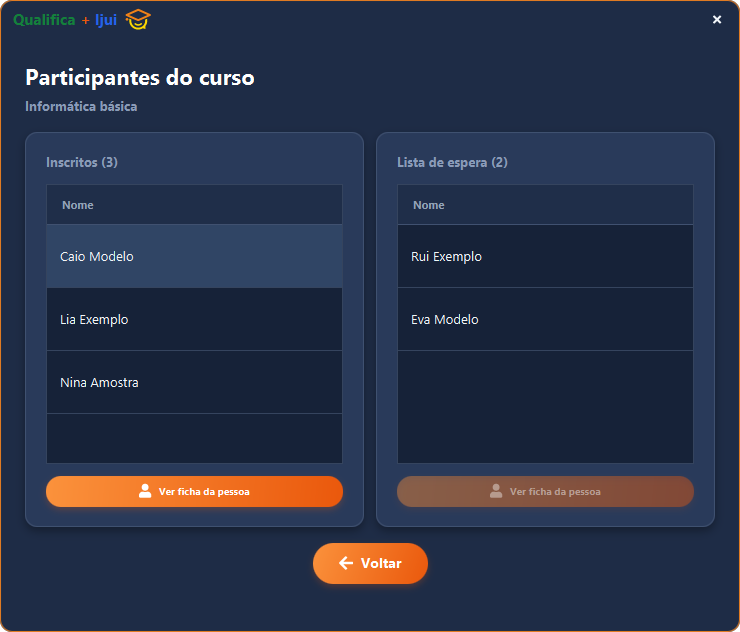
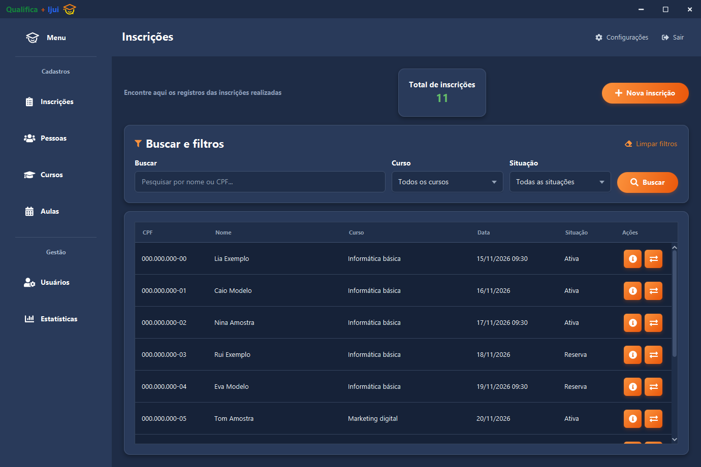
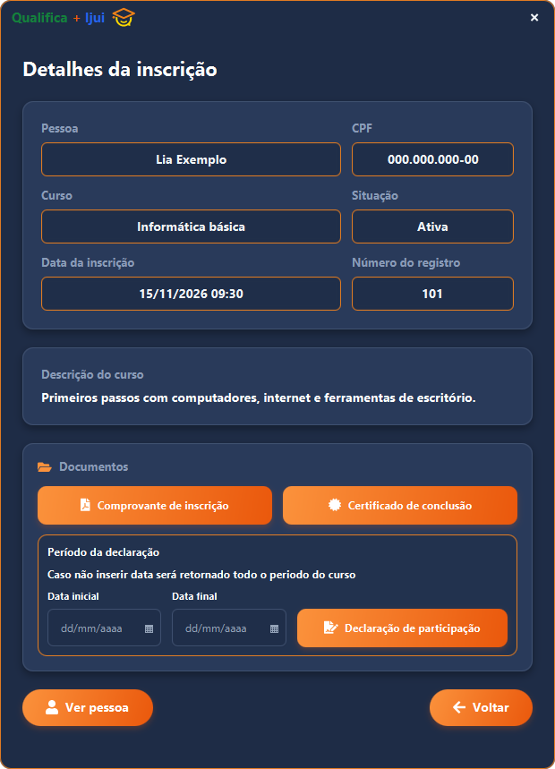
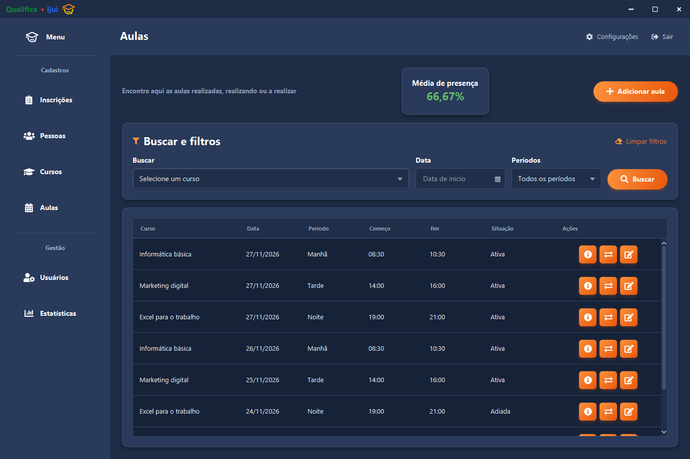
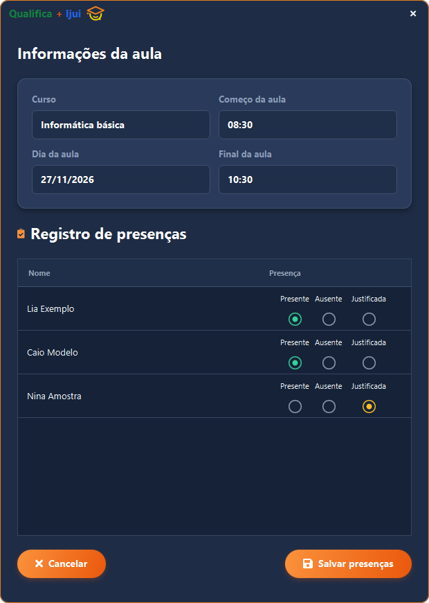
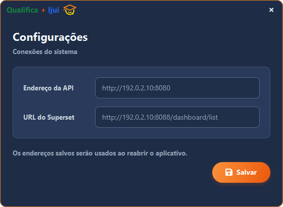

# Qualifica+ Ijuí — Desktop


Cliente desktop do **Qualifica+ Ijuí** para gestão de pessoas, cursos, inscrições, aulas e presenças. O aplicativo usa a API Qualifica para autenticação, cadastros e emissão de PDFs, e abre os painéis do Superset na área de Estatísticas.

[Interface](#interface) · [Funcionalidades](#funcionalidades) · [Como executar](#como-executar) · [Tecnologias](#tecnologias)

## Interface

A tela inicial reúne atalhos de cadastro, indicadores, aulas do dia, inscrições recentes e pendências de presença. As capturas usam dados fictícios.



<details>
<summary>Pessoas</summary>



</details>

<details>
<summary>Cursos, inscritos e lista de espera</summary>







</details>

<details>
<summary>Inscrições e documentos</summary>





</details>

<details>
<summary>Aulas e presenças</summary>





</details>

<details>
<summary>Configurações de conexão</summary>



</details>

## Funcionalidades

| Área | O que você pode fazer |
| --- | --- |
| **Pessoas** | Buscar pelo nome ou CPF, consultar fichas, cadastrar, editar e excluir pessoas. Baixar a ficha do participante e o histórico de participação. |
| **Cursos** | Buscar e filtrar cursos, editar dados e definir a quantidade máxima de participantes. Consultar a lista de inscritos, a lista de espera e a ficha de cada pessoa. |
| **Inscrições** | Inscrever pessoas, filtrar por curso e situação, cancelar e reativar inscrições. Emitir comprovante, declaração de participação e certificado de conclusão. |
| **Aulas** | Cadastrar aulas individuais ou em lote, consultar e editar a agenda e abrir a chamada. |
| **Presenças** | Registrar presente, ausente ou falta justificada. Consultar a média de presença segundo os filtros da listagem de aulas. |
| **Documentos do curso** | Baixar a relação de inscritos com contato opcional, o cronograma e o relatório de frequência. |
| **Estatísticas** | Acessar os painéis do Superset dentro do aplicativo. |
| **Configurações** | Editar e testar os endereços da API e do Superset antes de salvar. |

Nas tabelas compatíveis, selecione uma célula e pressione **Ctrl+C** para copiar seu conteúdo.

### Presenças e aulas em lote

A **Média de presença** divide o número de marcações como presente pelo total de lançamentos das aulas que atendem aos filtros. Ausências e faltas justificadas entram no total. Pessoas sem lançamento ficam fora do cálculo.

O cadastro em lote cria aulas nos dias da semana selecionados dentro do intervalo informado, incluindo a data final. A API recebe cada aula em uma requisição individual. Se houver uma falha, as aulas que já foram aceitas continuam cadastradas.

## Como executar

**Requisitos:** Windows, JDK 25, Maven, acesso à API Qualifica e uma conta cadastrada. O cliente usa a proteção de dados do Windows para armazenar a sessão.

No IntelliJ IDEA, importe o `pom.xml`, selecione o **JDK 25** e execute `com.qualificamaisanaliticinterface.HelloApplication`. Pelo terminal, na raiz do projeto:

```powershell
mvn javafx:run
```

Na tela de login, abra **Configurações de conexão**. Informe o endereço-base da API sem o sufixo `/api` e, se usar os painéis, informe o endereço do Superset. O botão **Salvar** testa os endereços preenchidos. Reabra o aplicativo para aplicar as alterações.

## Tecnologias

- **Java 25**, **JavaFX 21.0.6**, FXML e CSS na interface desktop.
- **Maven** para dependências e execução.
- **ControlsFX** para componentes de interface e **Ikonli / Font Awesome 5** para ícones.
- **Java HttpClient**, **CompletableFuture** e **Gson** na integração com a API.
- **JNA** para a proteção local da sessão no Windows.

## Estrutura do projeto

| Caminho | Conteúdo |
| --- | --- |
| `src/main/java/com/qualificamaisanaliticinterface` | Inicialização, controllers, serviços, sessão e navegação. |
| `src/main/resources/views` | Telas e diálogos em FXML. |
| `src/main/resources/css` | Estilos da interface. |
| `src/test/java` | Testes. |
| `docs/images` | Capturas da interface usadas no README. |
