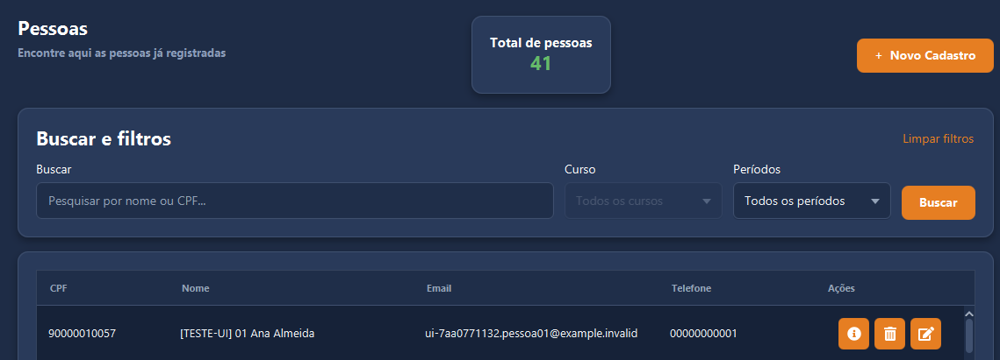
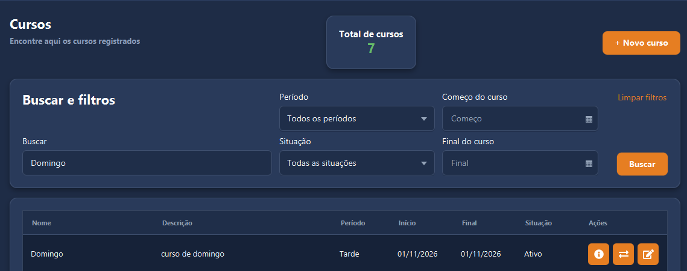
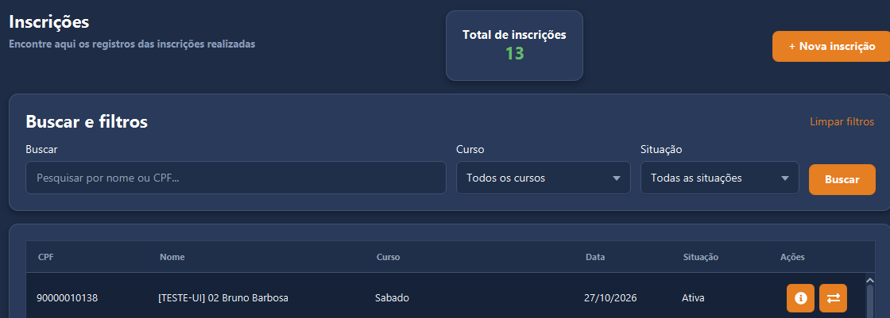
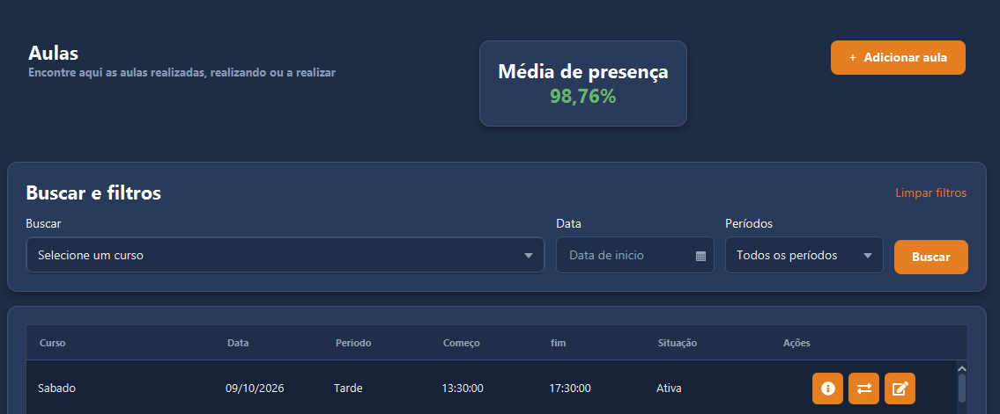

# Qualifica+ Ijuí — Desktop


Cliente desktop do **Qualifica+ Ijuí** para gestão de pessoas, cursos, inscrições, aulas e lançamentos de presença.

A interface utiliza **JavaFX**, layouts em **FXML** e estilos em **CSS**, com navegação lateral na mesma janela. O aplicativo já se integra à API Qualifica para autenticação, consulta e manutenção dos cadastros; não depende apenas de dados demonstrativos locais.

> Projeto em desenvolvimento. O cliente desktop é separado do backend e precisa de acesso à API para autenticar e realizar as operações.

## Funcionalidades

| Área | Recursos |
| --- | --- |
| **Pessoas** | Listagem e total de pessoas, pesquisa por nome ou CPF, cadastro, consulta da ficha, edição e exclusão. |
| **Cursos** | Cadastro, detalhes, edição, cancelamento e reativação; busca por nome e filtros de período, situação e datas de início e fim. |
| **Inscrições** | Inscrição de pessoas em cursos, consulta de detalhes, cancelamento e reativação; pesquisa por nome ou CPF e filtros por curso e situação. |
| **Aulas** | Cadastro individual ou em lote por intervalo de datas e dias da semana; consulta, edição de agenda, cancelamento e reativação; filtros por curso, data e período. |
| **Presenças** | Marcação de presente, ausente ou falta justificada por participante, com envio pelo botão de salvar e indicador de presença na listagem de aulas. |
| **Tabelas** | Seleção de células e cópia do valor selecionado com **Ctrl+C**. |
| **Sessão** | Autenticação pela API e tentativa de restauração da sessão salva ao iniciar o aplicativo. |

### Indicador de presença

O cartão **Média de presença** considera os lançamentos das aulas que atendem aos filtros da listagem:

- Sem filtros: reúne os lançamentos de todas as aulas retornadas pela consulta.
- Com curso, data ou período: utiliza somente as aulas correspondentes.
- Com vários filtros: aplica todos em conjunto.

Para conjuntos com lançamentos, o percentual é calculado assim:

```text
Percentual de presença = lançamentos PRESENT / total de lançamentos × 100
```

Os estados `ABSENT` e `JUSTIFIED` entram no total, mas não contam como presença. Pessoas sem lançamento não são consideradas ausentes automaticamente. O cálculo reúne os registros antes da divisão; não é uma média simples dos percentuais de cada aula.

### Cadastro de aulas em lote

O formulário permite selecionar um curso, as datas inicial e final, os horários e vários dias da semana. O intervalo inclui a data final e gera aulas somente nas datas correspondentes aos dias marcados.

Cada aula é enviada à API em uma requisição individual. O conjunto não constitui uma operação atômica: uma falha pode ocorrer depois de outras aulas já terem sido cadastradas.

## Telas

As capturas abaixo mostram a interface com registros de teste. Quantidades, nomes e percentuais são exemplos do momento da captura, não valores fixos do aplicativo.

### Pessoas

Pesquisa por nome ou CPF, total de cadastros e ações para consultar, excluir e editar.



### Cursos

Listagem com busca por nome, filtros de período, situação e datas, além das ações de consulta, alteração de situação e edição.



### Inscrições

Consulta de inscrições com pesquisa por nome ou CPF e filtros de curso e situação.



### Aulas

Listagem das aulas com filtros de curso, data e período, ações por linha e indicador de presença.



## Tecnologias

- **Java 25** e **Maven**.
- **JavaFX 21.0.6** para a interface e carregamento dos FXMLs.
- **ControlsFX 11.2.1** para controles como seletores pesquisáveis.
- **Java HttpClient** e **CompletableFuture** para comunicação assíncrona com a API.
- **Gson** para conversão de JSON.
- **Ikonli / Font Awesome 5** para ícones.
- **JNA** e proteção de dados do Windows para persistência local da sessão.

## Executar no IntelliJ IDEA

### Requisitos

- **Windows**: a implementação atual de armazenamento da sessão depende desse sistema.
- **JDK 25**.
- IntelliJ IDEA com o projeto importado pelo `pom.xml`.
- API Qualifica acessível e credenciais de um usuário cadastrado.

### Configuração e inicialização

1. Abra a pasta do projeto no IntelliJ e importe o `pom.xml` como projeto Maven.
2. Configure o SDK do projeto e o JDK utilizado para execução como **JDK 25**.
3. Configure a propriedade `api.base-url` em `src/main/resources/application.properties`, usando a origem da API, sem acrescentar `/api`:

   ```properties
   api.base-url=https://api.exemplo.invalid
   ```

   Substitua o endereço ilustrativo pelo endereço do seu ambiente. Para HTTPS, a JVM precisa confiar no certificado apresentado pela API.

4. Recarregue o projeto Maven após mudanças nas dependências.
5. Execute `com.qualificamaisanaliticinterface.HelloApplication`.
6. O aplicativo tenta restaurar a sessão salva; quando necessário, apresenta a tela de login para autenticação.

A sessão persistida é protegida pelo Windows e armazenada em `%LOCALAPPDATA%/QualificaMais/session.dat`. Não inclua esse arquivo, tokens ou credenciais no repositório.

## Estrutura

```text
src/main/
├── java/com/qualificamaisanaliticinterface/
│   ├── HelloApplication.java   # Inicialização e abertura da interface
│   ├── api/                    # Cliente HTTP e tratamento de erros da API
│   ├── config/                 # Leitura da configuração do aplicativo
│   ├── features/               # Controllers, serviços, DTOs e células por funcionalidade
│   ├── navigation/             # Navegação e abertura de formulários
│   ├── session/                # Sessão em memória, restauração e armazenamento no Windows
│   └── utils/                  # Utilitários compartilhados, incluindo cópia das tabelas
└── resources/
    ├── application.properties  # Configuração da URL da API
    ├── views/                  # Layouts FXML
    ├── css/                    # Estilos da interface
    └── images/                 # Imagens e ícones do aplicativo

docs/images/                    # Capturas de tela usadas neste README
```
